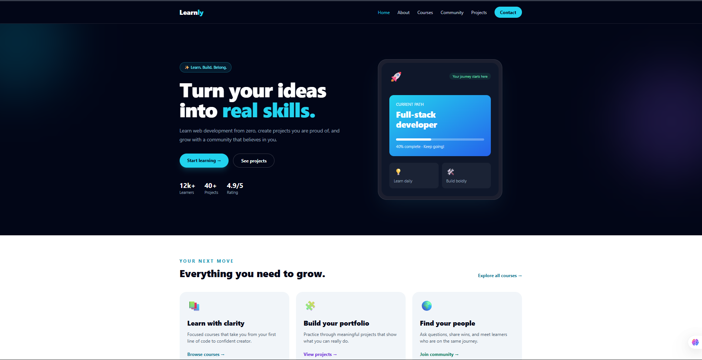

# Learnly

## look here https://baroh.netlify.app/
> Learn. Build. Belong.

Learnly is a polished, responsive learning platform landing site for curious people who want to learn practical web-development skills, build portfolio projects, and grow with a supportive community.

The project is intentionally lightweight: it is made from plain HTML and uses Tailwind CSS through the browser CDN. There is no build pipeline, framework, package manager, or backend to configure.

<p align="center">
	<a href="https://github.com/brahim1-dev/learnly">
		
	</a>
</p>

<p align="center"><strong>Click the Learnly preview above to open the project.</strong></p>

## What is included

- **Home** - A welcoming overview of the Learnly learning journey
- **About** - The platform's mission and learning principles
- **Courses** - Frontend, JavaScript, and backend course cards
- **Community** - Ways learners can connect, ask questions, and share progress
- **Projects** - Example portfolio projects learners can create
- **Contact** - A responsive contact form with client-side success feedback
- **Responsive navigation** - Desktop links and mobile menu controls on the main pages
- **Responsive layouts** - Mobile-first sections, grids, buttons, and forms
- **Tailwind styling** - Dark slate surfaces, cyan accents, responsive typography, and utility-first layouts

## Preview

The main page presents the product promise immediately:

> Turn your ideas into real skills.

From there, visitors can move through the learning funnel:

`Courses` -> `Projects` -> `Community` -> `Contact`

## Project structure

```text
.
├── index.html          # Homepage
├── about.html          # About Learnly
├── courses.html        # Course catalog
├── community.html      # Community overview
├── cumunity.html       # Backwards-compatible redirect to community.html
├── projects.html       # Learner project showcase
├── contact.html        # Contact form
├── image/
│   ├── bra.png         # Local image asset
│   └── logo.png        # Local image asset
└── README.md
```

## Run locally

### Option 1: Open directly

Open `index.html` in a browser. This works because the project is made of static files.

### Option 2: Use a local server

A local server gives you a more realistic browser environment and makes navigation easier:

```bash
python -m http.server 5500
```

Then open [http://localhost:5500](http://localhost:5500).

In VS Code, you can also use the **Live Server** extension and open `index.html` with **Open with Live Server**.

## Important technical notes

- Tailwind CSS is loaded from `https://cdn.tailwindcss.com`, so an internet connection is needed for the styling to appear when the site is opened.
- No `npm install` or build command is required.
- The contact form prevents a real submission and displays a success message in the browser. Connect it to a form provider or backend before using it in production.
- Course and project actions currently route visitors to `contact.html`.
- The canonical community page is `community.html`; `cumunity.html` is retained as a compatibility redirect for the misspelled filename.

## Customization

1. Update page copy and navigation targets in the HTML files.
2. Change Tailwind utility classes to adjust colors, spacing, typography, and responsive behavior.
3. Replace the placeholder contact details in `contact.html`.
4. Connect the contact form to your preferred backend or form service.
5. Replace the numeric homepage metrics with real product data before publishing.
6. Add real course, project, and community links as those experiences become available.

## Browser support

Learnly uses modern HTML, CSS, JavaScript, and responsive layout utilities. Use a current version of Chrome, Edge, Firefox, or Safari for the best experience.

## License

No license has been specified for this project yet. Add a license file before distributing the code publicly.

---

Made for curious minds by Learnly.
https://github/brahim1-dev.
